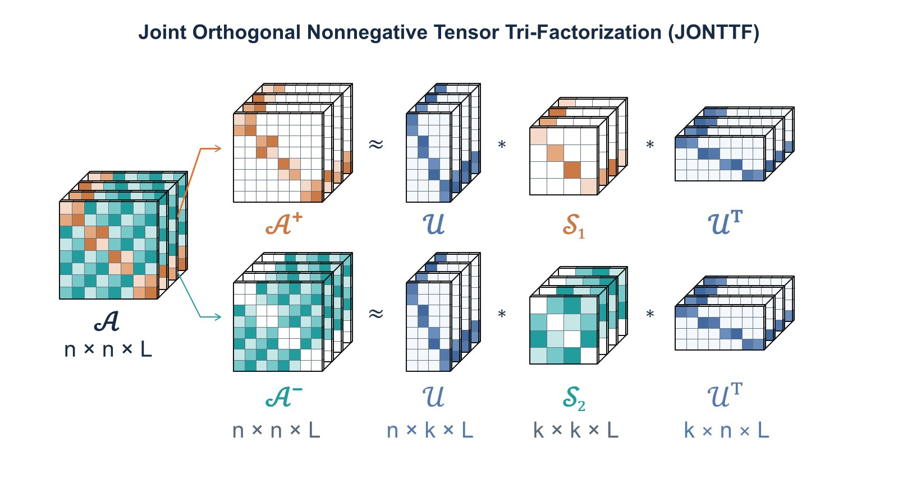

# JONTTF — Signed Multiplex Network Community Detection

**Author:** Sema Athamnah  
**Email:** athamnah@msu.edu  
**Affiliation:** Department of Biomedical Engineering, Michigan State University

## Method Overview

*Overview of JONTTF for signed multiplex networks, jointly modeling positive and negative edges through a shared node membership tensor.*

## Publication

Sema Athamnah and Selin Aviyente, *Joint Orthogonal Nonnegative Tensor Tri-Factorization for Community Detection in Signed Multiplex Networks.*

**Status:** Submitted to the IEEE International Symposium on Biomedical Imaging (ISBI 2027).

Citation details and DOI will be added when available.

## Repository Structure

- `main.m` — Evaluate JONTTF on one sample at each available SSBM noise level for NB and NW, and display best-NMI plots.
- `funs/` — JONTTF solver, grid search, clustering evaluation, and numerical helper functions.
- `images/JONTTF.jpg` — Method overview figure.
- `data/` — SSBM datasets.

## Usage

1. Add both SSBM `.mat` files to `data/`.
2. Open MATLAB, set the current folder to the repository root, and run `main`.
3. The script performs a grid search for each noise level using `lambda1 = [0.01, 0.1, 1, 10, 100, 1000]`, `lambda2 = 1`, and `p = 1`.
4. The script displays NMI plots for NB and NW. It does not save results or figures to disk.

The script uses the first sample at each noise level. Ground-truth labels are used for evaluation and to determine the number of communities, not for fitting. The `.mat` data layout has not yet been verified against uploaded datasets.
